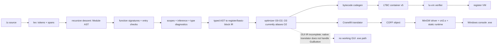
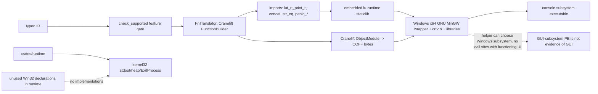
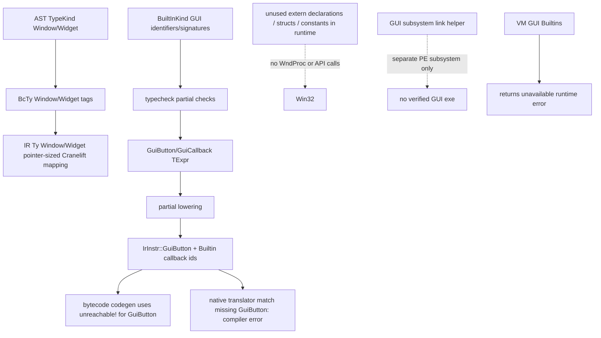

# Lutetium architecture (observed implementation)

**Snapshot:** 2026-11-12 working tree, package 0.4.1. This document describes existing source. GUI portions labelled “incomplete” are only observed scaffolding, not an executable subsystem.

## 1. Crate dependency architecture

```mermaid
flowchart TD
  diag[lu-diagnostics]
  syntax[lu-syntax]
  vm[lu-vm: bytecode + verifier + VM + GC]
  compiler[lu-compiler: resolve/typecheck/IR/lower/opt/codegen]
  native[lu-native: Cranelift + COFF + linker]
  cli[lutetium-cli: library + binary]
  runtime[lu-runtime staticlib source]
  syntax --> diag
  compiler --> syntax
  compiler --> diag
  compiler --> vm
  native --> compiler
  cli --> compiler
  cli --> vm
  cli --> native
  native -. build.rs runs rustc on .-> runtime
```

The VM crate does not depend on the compiler. `lu-runtime` is not a workspace member and has no Cargo dependencies; `crates/native/build.rs` compiles its single source file directly via `rustc --crate-type staticlib` and `include_bytes!` embeds it. The graph does not show OS tools: Windows native executable linking requires rustup's bundled GNU MinGW driver/libs.

## 2. Source-to-executable pipelines



`compile_ir_with_opts` stops at typed IR; `compile_source` bytecode-generates. CLI `run` verifies bytecode before VM execution. Bytecode `build` verifies before serialize. Native build compiles from IR and skips bytecode generation/verifier, relying on compiler IR validity. Existing console native backend emits a `main` symbol and links console subsystem. A helper `build_gui_exe` and linker `--subsystem,windows` exist, but the CLI has no GUI build target, current IR is non-exhaustive in backend, and runtime has no implementation of GUI imports/events.

## 3. VM lifecycle and call mechanics

```mermaid
sequenceDiagram
  participant CLI
  participant Compiler
  participant Verifier
  participant VM
  participant Heap
  CLI->>Compiler: lex/parse/resolve/typecheck/lower/codegen
  Compiler-->>CLI: BytecodeModule
  CLI->>Verifier: verify(module)
  Verifier-->>CLI: success or E4002
  CLI->>VM: run_with_options(module, output sink, options)
  VM->>VM: create entry Frame, nregs Uninit registers
  loop instruction dispatch
    VM->>VM: decode opcode operands and execute
    opt CALL
      VM->>VM: copy args to new Frame registers; cap depth at 1024
      VM->>VM: RET writes result to caller destination and resumes
    end
    opt allocation builtin
      VM->>Heap: collect roots from all frame registers when thresholds/stress require
      Heap-->>VM: allocation / updated counters
    end
    opt PRINT
      VM-->>CLI: formatted value with newline
    end
  end
  VM-->>CLI: Value + GcStats or VmError(E5001-E5009)
```

The VM is a register machine, not a bytecode operand-stack VM. Frames hold current function index, instruction pointer, return destination/IP, and registers. The bytecode runtime is independent of the frontend. `verify` checks opcode shapes, operand ranges, constants/calls/builtin arities, branch targets and register definitions. It does not perform full static type validation of arbitrary hand-crafted bytecode; VM checks runtime value kinds and returns errors.

## 4. Memory / collector

```mermaid
flowchart TD
  regs[All live frame register Vec<Value>] --> mark[Root mark]
  old[Old remembered slots] --> mark_young[Minor GC traces young children]
  mark --> queue[worklist of Ref handles]
  queue --> children[List/Map child values]
  children --> queue
  queue --> sweep[young sweep]
  sweep --> dead[unmarked: free slot + account bytes]
  sweep --> survive[marked: reset mark, age++]
  survive --> promote[age >= 2 -> Old]
  mutate[old List/Map mutation] --> barrier[write_barrier(slot)]
  barrier --> old
  roots[Roots] --> full[Major GC: trace both generations]
  children --> full
  full --> sweep_all[sweep both; revalidate remembered set]
```

`Heap` stores `Obj::List(Vec<Value>)` and insertion-ordered `Obj::Map(Vec<(Value,Value)>)` in indexed slots, with `Ref=u32`; strings are `Rc<str>` and are not traced. Default thresholds: young 1024, old 8192; stress mode requests minor collection at each `maybe_collect`. Collection call sites are currently allocation builtins in VM. Lists/maps are mutable and alias-visible. Approximate object byte stats count internal vector estimates, exclude allocator/vector capacity and external string payload. Minor and major tests exist.

## 5. Native runtime and linker



Native supported IR values in practice: int i64, float f64, bool i8, str pointer to `[u64 byte length][UTF-8 bytes]`, unit dummy/no return. Calls are WindowsFastcall. Literals are read-only data, concatenation uses `HeapAlloc`, string comparison runtime. Integer overflow/div-by-zero branches to panic runtime. The static runtime currently links with console behavior; no allocations are reclaimed. Linker always uses `x86_64-pc-windows-gnu` rustup sysroot MinGW and `crt2.o`; console `link_exe` adds `--subsystem,console`; `link_gui_exe` adds `--subsystem,windows` plus `-luser32 -lgdi32`.

## 6. GUI integration points and gaps



There is no `std/ui`, reusable component representation, rendering command protocol, layout calculation, state model, focus/event abstraction, text/shape renderer, D2D/DWrite/DWM integration, DPI-awareness setup, mouse/keyboard event dispatch, callback trampoline, handle cleanup, or GUI test/example. `RegisterClassExW`, `CreateWindowExW`, `DefWindowProcW`, `GetMessageW`, `TranslateMessage`, `DispatchMessageW`, `PostQuitMessage` and supporting types are declarations only in `crates/runtime/src/lib.rs`; grep/source inspection found no implementation calls. The GUI identifiers are in `BuiltinKind::function_name_of`, but some GUI methods are not yet handled in checker and `function_name()` does not enumerate them; signatures are not all semantically consistent (see known issues). This is incomplete scaffolding and actively contributes to current build failure.

## 7. Language-to-native machine code

The compiler does not parse into bytecode and JIT it. It produces shared typed IR; native lowering translates each IR basic block to Cranelift blocks, maps Lutetium registers to Cranelift variables, emits primitive machine-level operations and imported runtime calls, writes COFF object bytes, then a separate link process builds a PE executable. The build target is fixed by `.cargo/config.toml` and `target_isa()` to x86_64 Windows GNU. There is no Linux/macOS/ARM native path. `--release` on Lutetium CLI is a reporting/accepted flag for this generated build; the `build_native` body does not alter Cranelift optimization settings based on it. Cargo release profile affects building the compiler, not the language program's native compiler optimization level.
